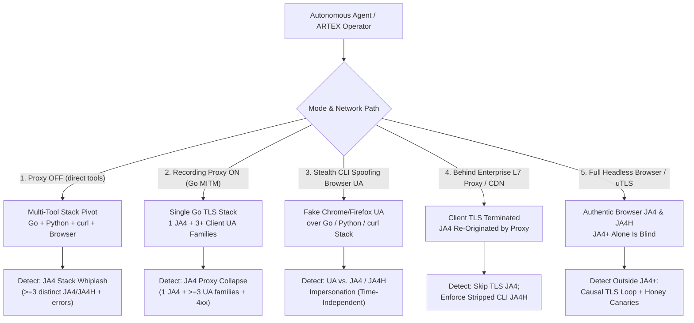

# JA4+ Hunting Guide for ARTEX & Agentic AI Threats

> [!CAUTION]
> **DO NOT BLOCK ON STATIC JA4 OR JA4H HASHES ALONE.**
> No public advisory or lab capture has identified an "ARTEX-only" static `JA4` fingerprint. ARTEX, ScopeWeaver, and adjacent agentic frameworks are compiled in **Go** (`crypto/tls`, `net/http`) and orchestrate standard CLI/SDK stacks (**`curl`**, **Python `urllib` / `httpx` / `requests`**, **`nuclei`**, headless browsers). Every static Go, OpenSSL, or `curl` `JA4` hash matches millions of benign services (Kubernetes, Terraform, Docker, Prometheus, CI runners, cloud SDKs) and drifts across compiler/OpenSSL upgrades. Treat static runtime `JA4`/`JA4H` hashes strictly as **stack-classification and correlation pivots**, never as standalone firewall/WAF deny-lists.

This standalone guide is written for detection engineers and threat hunters who want actionable **FoxIO `JA4` / `JA4H` / `JA4S` / `JA4X`** hunting patterns for ARTEX and autonomous LLM agents—without needing to deploy the full `artex-defense` workbench. A printable 3-page illustrated briefing snapshot (diagrams + live-measured reference tables) is also available at [docs/ja4_agentic_detection_nuances.pdf](ja4_agentic_detection_nuances.pdf).

---

## 1. How Agentic Frameworks Actually Appear on the Wire



---

## 2. Five Reasons Static JA4 Blocklists Break in Production

1. **Compiler & TLS Library Drift (Measured Live Below):** Upgrading Go from `1.22` -> `1.23`/`1.24` changes `JA4_a` (`14` -> `13` ciphers) and `JA4_b` (`cbb2034c60b8` -> `f57a46bbacb6`) while adding ~1.2 KB of post-quantum key-share bytes. Upgrading OpenSSL from `3.0` (Debian 12) -> `3.6.5` changes Python `urllib`'s `JA4_a` (`31` -> `17` ciphers), `JA4_b`, and `JA4_c`. A hardcoded full-JA4 rule silently goes blind on the next rebuild.
2. **Massive Benign Overlap:** Go's default TLS 1.3 fingerprint (`t13d1311h2_f57a46bbacb6_e7c285222651`) is identical across ARTEX, Nuclei, Terraform, `kubectl`, Docker, Prometheus, and countless legitimate microservices.
3. **ARTEX's Recording-Proxy Collapse (`andpalmier` Finding):** When ARTEX runs with its built-in Go traffic-recording MITM proxy enabled, every downstream tool (`curl`, `python`, headless browser) collapses into **one single Go `JA4`** on the wire—the exact opposite of unproxied multi-tool JA4 whiplash.
4. **Enterprise L7 Reverse Proxies & CDNs:** WAFs, load balancers, and ingress proxies terminate client TLS and re-originate upstream TLS using the proxy's own `JA4`. Downstream sensors see the proxy's `JA4` paired with customer browser UAs—triggering massive false positives unless TLS `JA4` checks are disabled for trusted proxy IPs (while keeping `JA4H` active).
5. **uTLS & Headless-Browser Evasion:** An operator running Playwright/Chromium or a Go `uTLS` Chrome impersonation wrapper emits a legitimate browser `JA4` and `JA4H`. At that boundary, JA4+ cannot distinguish the agent from a human—defenders must rely on behavioral cadence, encrypted `TLS_IN -> Action -> TLS_OUT` causal coupling, and deterministic deception canaries.

---

## 3. Wire-Verified Runtime Reference Fingerprints (Enrichment Only — Not Blocklists)

All values below were captured from live TCP/TLS/HTTP handshakes inside isolated `--network=none` containers (`golang:1.22-alpine`, `golang:1.23-alpine`, `golang:1.24-alpine`, Debian 12 Python/OpenSSL, and Linux `curl`/`httpx`) and computed using the FoxIO `JA4` / `JA4H` specification. Machine-readable JSON: [rules/intel_hunting/ja4_agentic_patterns.json](../rules/intel_hunting/ja4_agentic_patterns.json).

### 3.1 Go `crypto/tls` + `net/http` (Core Runtime for ARTEX, ScopeWeaver, Nuclei, `norma`)

| Go Version | Mode | Observed Wire `JA4` | ClientHello Size | Key Takeaway |
| :--- | :--- | :--- | ---: | :--- |
| **Go 1.22.12** | Default `net/http` (HTTP/2, SNI) | `t13d1411h2_cbb2034c60b8_e7c285222651` | 274 B | `14` ciphers, `11` exts, ALPN `h2` |
| **Go 1.22.12** | HTTP/1.1 only (`TLSNextProto={}`, SNI) | `t13d141000_cbb2034c60b8_e7c285222651` | 256 B | Missing ALPN (`00`) |
| **Go 1.22.12** | Default `net/http` (raw IP, no SNI) | `t13i1410h2_cbb2034c60b8_e7c285222651` | 251 B | **`t13i`** (no SNI) |
| **Go 1.22.12** | Capped at TLS 1.2 (SNI) | `t12d1110h2_cba83a0ed4ae_824bd91ab3e2` | 224 B | **`t12d`** fallback |
| **Go 1.23.12** | Default `net/http` (HTTP/2, SNI) | `t13d1311h2_f57a46bbacb6_e7c285222651` | 1,494 B | `JA4_a`/`JA4_b` drifted (`13` ciphers, PQ keyshare); **`JA4_c` unchanged** |
| **Go 1.23.12** | HTTP/1.1 only (no ALPN, SNI) | `t13d131000_f57a46bbacb6_e7c285222651` | 1,476 B | Missing ALPN (`00`), **`JA4_c` unchanged** |
| **Go 1.23.12** | Default `net/http` (raw IP, no SNI) | `t13i1310h2_f57a46bbacb6_e7c285222651` | 1,471 B | **`t13i`** (no SNI), **`JA4_c` unchanged** |
| **Go 1.24.13** | Default `net/http` (HTTP/2, SNI) | `t13d1311h2_f57a46bbacb6_e7c285222651` | 1,494 B | Matches Go 1.23.12 (`X25519MLKEM768` PQ keyshare) |
| **Go 1.24.13** | Default `net/http` (raw IP, no SNI) | `t13i1310h2_f57a46bbacb6_e7c285222651` | 1,471 B | **`t13i`** (no SNI) |
| **Go 1.24.13** | Capped at TLS 1.2 (SNI) | `t12d1010h2_a8cf61a50a39_824bd91ab3e2` | 222 B | **`t12d`** fallback |

> [!TIP]
> **Critical Go Nuance for JA4 Analysts:** Notice two things in the table above:
> 1. **`JA4_c = e7c285222651` stayed constant across Go 1.22, 1.23, and 1.24** (because FoxIO JA4 excludes SNI and ALPN from `JA4_c`), making `JA4_c` a far cleaner Go-TLS stack classifier than full `JA4`—still **enrichment-only**, never a blocklist.
> 2. **Go 1.23/1.24 `JA4_a` (`t13d1311h2`) looks structurally close to a modern browser** (`13` ciphers, `11` extensions, `h2`). That is why pairing **TLS `JA4`** with **HTTP `JA4H`** is essential: even when a Go agent spoofs `User-Agent: Chrome/131.0.0.0`, Go `net/http` still emits only 3 stripped headers (`ge11nn030000_cd680697de12_000000000000_000000000000`).

### 3.2 Python & `curl` (Core Subprocess & LLM SDK Tool Stacks)

| Runtime / Library (Exact Version) | Observed Wire `JA4` | Structural Giveaway (`JA4_a`) |
| :--- | :--- | :--- |
| **Python 3.11 / OpenSSL 3.0** (`urllib`/`http.client`, SNI, Debian 12) | `t13d311100_e8f1e7e78f70_d41ae481755e` | `31` ciphers (`>=26`), ALPN `00` |
| **Python 3.11 / OpenSSL 3.0** (raw IP, no SNI) | `t13i311000_e8f1e7e78f70_d41ae481755e` | `t13i` (no SNI), `31` ciphers, ALPN `00` |
| **Python 3.11 / OpenSSL 3.0** (ALPN `h2` / `http/1.1`) | `t13d3112h2_e8f1e7e78f70_d41ae481755e` / `t13d3112h1_e8f1e7e78f70_d41ae481755e` | `31` ciphers (`>=26`) |
| **Python 3.14 / OpenSSL 3.6.5** (`urllib`/`ssl`, SNI) | `t13d171200_ab0a1bf427ad_ecd0401ec68b` | ALPN `00` (notice cipher count dropped `31 -> 17`!) |
| **`curl` 8.23.0 / OpenSSL 3.6.5** (SNI, HTTP/2) | `t13d3013h2_1d37bd780c83_8537cf56674e` | `30` ciphers (`>=26`) |
| **`curl` 8.23.0 / OpenSSL 3.6.5** (raw IP, no SNI) | `t13i3012h2_1d37bd780c83_8537cf56674e` | `t13i` (no SNI), `30` ciphers (`>=26`) |
| **Python / OpenSSL TLS 1.2 fallback** (SNI) | `t12d280700_d943125447b4_e7e480e5a997` | `t12`, `28` ciphers, `07` exts, ALPN `00` |

### 3.3 HTTP Header Fingerprints (`JA4H`) — Why `JA4H` Outlasts `JA4` Drift

| Client Stack | Observed Wire `JA4H` | Header Count & `Accept-Language` |
| :--- | :--- | :--- |
| **Go 1.22 / 1.23 / 1.24 `net/http` `GET`** (default **and** Chrome-UA spoofed!) | `ge11nn030000_cd680697de12_000000000000_000000000000` | `03` headers (`Host`, `User-Agent`, `Accept-Encoding`), `lang=0000` |
| **Go 1.22 / 1.23 / 1.24 `net/http` `POST` JSON** | `po11nn050000_a9e6c43a0296_000000000000_000000000000` | `05` headers, `lang=0000` |
| **`curl` 8.x `GET`** (default headers) | `ge11nn030000_fe444ad14866_000000000000_000000000000` | `03` headers, `lang=0000` |
| **Python `urllib` `GET`** (default headers) | `ge11nn040000_5b1e8b5f4d2d_000000000000_000000000000` | `04` headers, `lang=0000` |
| **Python `httpx` 0.28.1 `GET`** (OpenAI/Anthropic/MCP agents) | `ge11nn050000_be0d0b335e46_000000000000_000000000000` | `05` headers, `lang=0000` |
| **Authentic Chrome / Firefox `GET` (contrast)** | `ge11nn09enus_5e81b34521f1_000000000000_000000000000` | `>=09` headers + real `Accept-Language` (`enus`) |

---

## 4. Six Durable Hunting Patterns (Copy-Paste Queries)

### 4.1 Browser-UA vs. Non-Browser `JA4` / `JA4H` Impersonation (Cloudflare WAF / Splunk / KQL)

**Why it works:** Even a 12-second-paced stealth agent spoofing `Chrome/131` from `curl`, Python, or Go `net/http` fails TLS/HTTP header authenticity on the very first request. Always exclude honest automation (`HeadlessChrome`, `Playwright`, `Selenium`, `Cypress`, `; wv)`), CORS `OPTIONS` (`op*`), proxy `CONNECT` (`co*`), health probes (`/healthz`, `/metrics`), and L7 reverse proxies (skip TLS `JA4`, keep `JA4H`).

```spl
/* Splunk SPL — Browser-UA Stack Impersonation (JA4 or Stripped CLI JA4H) */
index=web_or_proxy
| where match(coalesce(http_user_agent, ""), "(Chrome|Firefox|Edg)/(9[0-9]|1[0-9]{2})")
  AND NOT match(coalesce(http_user_agent, ""), "(?i)(HeadlessChrome|Electron/|Playwright|Selenium|Cypress|;\\s*wv\\)|Googlebot|bingbot)")
  AND NOT match(coalesce(uri_path, ""), "(?i)^/(healthz?|readyz?|livez?|metrics|status|ping)/?$")
| eval ja4_mismatch=if(
    isnotnull(ja4) AND (
      match(ja4, "^t(10|11|12)[di]")
      OR match(ja4, "^t[0-9]{2}[di][0-9]{4}00_")
      OR match(ja4, "^t13[di](2[6-9]|[3-9][0-9])[0-9]{2}")
      OR match(ja4, "^t13[di][0-9]{2}0[0-8]")
    ), 1, 0)
| eval ja4h_mismatch=if(
    isnotnull(ja4h) AND match(ja4h, "^(?!op|co)[a-z]{2}[0-9]{2}[cn][rn]0[0-5]0000_"),
    1, 0)
| where ja4_mismatch=1 OR ja4h_mismatch=1
| stats count dc(uri_path) AS distinct_paths values(ja4) AS ja4s values(ja4h) AS ja4hs values(http_user_agent) AS uas by src_ip, dest_host
| where distinct_paths >= 2
| sort - count
```

### 4.2 Unproxied JA4 Stack Whiplash vs. Recording-Proxy JA4 Collapse (DuckDB / Spark SQL)

```sql
-- Run against Zeek/YAF/Proxy flows enriched with ja4, ja4h, user_agent, status_code
WITH windowed AS (
  SELECT
    source_host,
    dest_host,
    COUNT(DISTINCT NULLIF(TRIM(ja4), ''))  AS distinct_ja4,
    COUNT(DISTINCT NULLIF(TRIM(ja4h), '')) AS distinct_ja4h,
    COUNT(DISTINCT CASE
      WHEN COALESCE(TRIM(user_agent), '') = '' THEN NULL
      WHEN user_agent ILIKE '%curl/%'          THEN 'curl'
      WHEN user_agent ILIKE '%python%'         THEN 'python'
      WHEN user_agent ILIKE '%Go-http%'        THEN 'go'
      WHEN user_agent ILIKE '%Chrome/%'        THEN 'chrome'
      WHEN user_agent ILIKE '%Firefox/%'       THEN 'firefox'
      WHEN user_agent ILIKE '%Nuclei%'         THEN 'nuclei'
      ELSE LEFT(user_agent, 20)
    END) AS distinct_ua_families,
    SUM(CASE
      WHEN status_code >= 400
       AND COALESCE(http_path, '') NOT ILIKE '%.ico'
       AND COALESCE(http_path, '') NOT ILIKE '%.png'
       AND COALESCE(http_path, '') NOT ILIKE '%.css'
       AND COALESCE(http_path, '') NOT ILIKE '%.js'
      THEN 1 ELSE 0
    END) AS non_asset_4xx
  FROM web_tls_telemetry
  WHERE ts >= NOW() - INTERVAL 30 MINUTE
  GROUP BY source_host, dest_host
)
SELECT
  *,
  CASE
    WHEN distinct_ja4 = 1 AND distinct_ua_families >= 3 AND non_asset_4xx >= 3
      THEN 'JA4_PROXY_COLLAPSE (Go MITM Proxy ON)'
    WHEN (distinct_ja4 >= 3 OR (distinct_ja4h >= 3 AND distinct_ua_families >= 2)) AND non_asset_4xx >= 3
      THEN 'JA4_STACK_WHIPLASH (Proxy OFF)'
  END AS pattern
FROM windowed
WHERE (distinct_ja4 = 1 AND distinct_ua_families >= 3 AND non_asset_4xx >= 3)
   OR ((distinct_ja4 >= 3 OR (distinct_ja4h >= 3 AND distinct_ua_families >= 2)) AND non_asset_4xx >= 3);
```

### 4.3 Raw-IP TLS (`t13i` / `t12i`) & Go-Stack Correlation Pivot (KQL — Sentinel / MDE Network / Zeek)

```kql
// Hunt raw-IP TLS handshakes (no SNI -> JA4 char 4 == 'i') or Go TLS 1.3 JA4_c on non-standard ports
NetworkTlsTelemetry
| where TimeGenerated > ago(24h)
| where JA4 startswith "t13i" or JA4 startswith "t12i"
   or (JA4 endswith "_e7c285222651" and RemotePort in (8443, 8787, 8788, 8790, 8890, 18899))
| summarize Flows=count(), BytesOut=sum(SentBytes), BytesIn=sum(ReceivedBytes),
            DistinctJA4=make_set(JA4, 10), Ports=make_set(RemotePort, 10)
            by SrcIp, DstIp, Sni
| where Flows >= 3
| sort by BytesOut desc
```

### 4.4 Self-Signed Console & Relay Clustering (`JA4X` + `JA4S`)

Look for exposed ARTEX / ScopeWeaver management panels and bespoke TLS relays without relying on `Issuer O=ARTEX` strings:
- Filter `ja4x_a == ja4x_b` (self-signed certificate structure) and exclude your top 25 public CAs (`Let's Encrypt`, `DigiCert`, `Google Trust Services`, `Sectigo`).
- Group by `(ja4x_c, ja4s, dest_port)` across `8787`, `8788`, `8790`, `8890`, `8443` — see full SQL templates in [docs/production_adaptation_pack.md](production_adaptation_pack.md).

---

## 5. Summary: What JA4+ Can and Cannot Do

| Question | Answer |
| :--- | :--- |
| Can static `JA4` catch an unproxied ARTEX scan by itself? | **No** — too many benign Go/OpenSSL/curl hits, and hashes drift across Go 1.22 -> 1.23 and OpenSSL 3.0 -> 3.6. |
| Can `JA4` + `JA4H` catch a stealth agent spoofing Chrome even at slow cadence? | **Yes** — `browser_ua_stack_impersonation` is time-independent and survives L7 proxies via `JA4H`. |
| Can `JA4` catch ARTEX with its Go recording proxy enabled? | **Yes, if you look for the inverse** — `1` constant `JA4` carrying `>=3` distinct client UA families during 4xx probing (`ja4_proxy_collapse_multi_ua`). |
| What if the attacker uses real Chromium/Playwright or `uTLS`? | **JA4+ goes blind** — pair JA4+ with encrypted causal `TLS_IN -> Action -> TLS_OUT` loop detection (`causal_tls_action_loop`), host `auditd`/EDR, and deterministic honey-route/honey-token deception canaries. |
